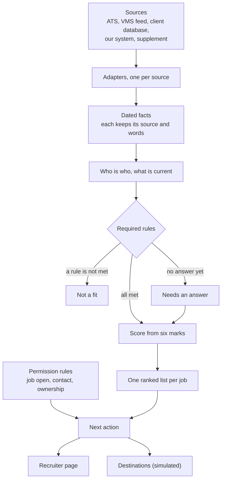

# Tracefit

Candidate–job matching for recruiters. When a job arrives, Tracefit checks every person against it in two stages: **can they do this job** (required rules: met, not met, or unknown), then **how good a fit are they** (a score out of 100 from six named marks). Every result shows the quote and source behind it, what is still unknown, and what the recruiter may do next. It recommends; it contacts nobody and submits nothing.

**Live demo:** https://tracefit-434887347109.us-central1.run.app (the same page, hosted, with only the fictional sample data).

## Run it

Python 3.11 or newer. Nothing to install, no account, no network.

```bash
python3 -m shortlist
```

Then open http://127.0.0.1:8765. To run the tests:

```bash
python3 -m unittest discover -s tests
```

The product is Tracefit; its code package and commands are named `shortlist`, after the list it builds for each job.

| Command | What it shows |
|---|---|
| `python3 -m shortlist replay` | The demo in text: the 18:00 snapshot, the 18:05 new job, the 18:10 candidate update |
| `python3 -m shortlist explain VMS-901 C2` | Every rule for one person and one job, with its quotes |
| `python3 -m shortlist baseline` | A simple field-and-keyword matcher on the same data, beside Tracefit |
| `python3 -m shortlist audit` | The checker: every result against the product's own rules |
| `python3 -m shortlist burst` | Eight **synthetic** events at the same moment: the same lists in any delivery order |
| `python3 -m shortlist worked` | Four candidates taken through both stages ([docs/WORKED_EXAMPLE.md](docs/WORKED_EXAMPLE.md)) |
| `python3 -m shortlist coverage` / `health` / `publish` | Every rule ran for every pair · data problems worked around · write the shortlists to the simulated destinations |
| `python3 tests/model_run.py` | The language-model reader's one recorded run, replayed with no key |
| `python3 bench/benchmark.py --n 100000` | The **synthetic** scale benchmark |

Add `--overlay feed_only` or `--overlay strict_pay` to a `shortlist` command to see another client's settings.

## Five-minute demo

1. **Home Health PT.** The banner says the account manager's note is ahead of the vendor feed; **See details** shows both versions and their sources.
2. **The list.** Twelve people, best first. R01, R02 and R03 differ only by id and email, so the page groups them, says their order is arbitrary, and names what to ask to tell them apart. R11 asked not to be contacted and is listed last.
3. **Open R04.** **Why this score** shows the six marks: R04 loses evidence points because "three years" is not supported by the dated history. Every rule opens to its quote.
4. **Rank by.** Pick **Within budget** or move the Pay slider: R06, who asks above the approved rate, drops from sixth to eighth. Type a skill (`sports injury`) and the list narrows to who says it.
5. **Compare** R04, R06 and R09 side by side.
6. **Demo → A new job arrives.** The outpatient job appears already matched, with Blair first at 96.
7. **Demo → A candidate sends an update.** Alex can now only start 8 December; one result changes.
8. **Demo → Settings profile → Vendor feed only.** With the account manager's note ignored, nobody qualifies for the home-health job: the client's first open question.

## How it works



When an event arrives, only what it touches is redone: a new job is matched once, a candidate update replaces that person's row in each open job, and a filled job withdraws its list. Applying events one at a time gives exactly the same lists as rebuilding from scratch.

## What is in it

| Folder | What is in it |
|---|---|
| `shortlist/` | The product. `sources/` and `sinks/` hold one adapter per source and destination (matching imports neither); `extract.py` and `resume.py` read text; `world.py` decides who is who; `rules.py`, `dimensions.py` and `matching.py` hold the rules, the score and the list; `pipeline.py` and `server.py` run events and serve `web/`; `audit.py` is the checker; `model_reader.py` is the optional language-model reader; `workers.py` splits work across processes; `baseline.py` is the comparison matcher. |
| `config/` | Every setting: rules, weights, presets, thresholds, source precedence, freshness, vocabulary. `overlays/` holds two other client profiles. |
| `tests/` | 231 tests, 110 synthetic scenarios, the rewording sweep, inputs unlike the sample, and `model_run.py`. |
| `recorded/` | The language-model reader's saved answers, so its run replays without a key. |
| `bench/` | The synthetic scale benchmark, run on a laptop and on Google Cloud; outputs in `docs/benchmark_*.txt`. |
| `docs/` | The written explanation (below), the benchmark outputs, the illustrated architecture (`architecture.pdf`), and a draft first message to the client. |
| `assessment-data/` | The supplied sample, unchanged. |
| `Dockerfile` | The hosted demo. |

## What is real and what is simulated

| Part | Status |
|---|---|
| Reading the supplied sources, rules, score, events, recruiter page, checker | Implemented, on the supplied data |
| Speed at 20,000 and 100,000 people | Measured on **synthetic** data, on a laptop and on a 16-core Google Cloud machine (a new job at 100,000 people: 7.1 s on one worker, 1.2 s on sixteen) |
| Destinations (JSON, CSV, notifications) | **Simulated**: local files only |
| Language-model reader | Off by default. Run once with `gpt-4o` on the sample: it changed no result |
| Database, queue, several machines, live connections, sign-in | Designed, not built |
| Credential checks | Not done: every license and certificate is shown as reported |

The text reader is pattern-based and is the weakest part: wording unlike the sample's can be left unread or misread. [Evaluation](docs/EVALUATION.md) says what review found and what is still open.

## Read more

- [Architecture](docs/ARCHITECTURE.md): matching, scoring, configuration, scale and cost. Also as an [illustrated PDF](docs/architecture.pdf).
- [Evaluation](docs/EVALUATION.md): why the results are useful, the tests, and the limits.
- [Handoff](docs/HANDOFF.md): assumptions, [questions for the client](docs/HANDOFF.md#questions-for-the-client), what is built, onboarding, and how AI was used.
- [Worked example](docs/WORKED_EXAMPLE.md): four candidates, rule by rule.
