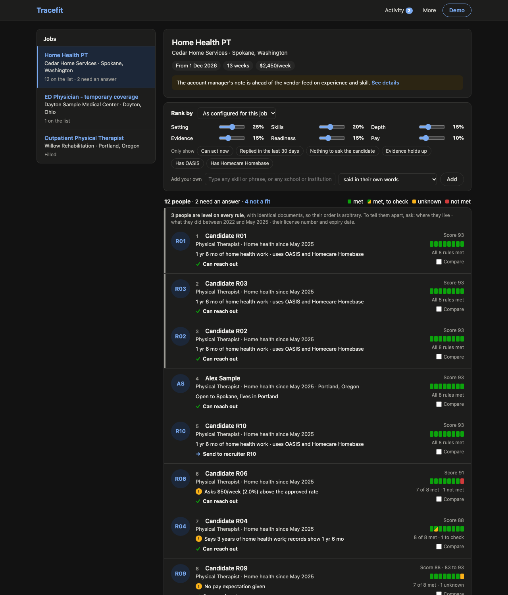
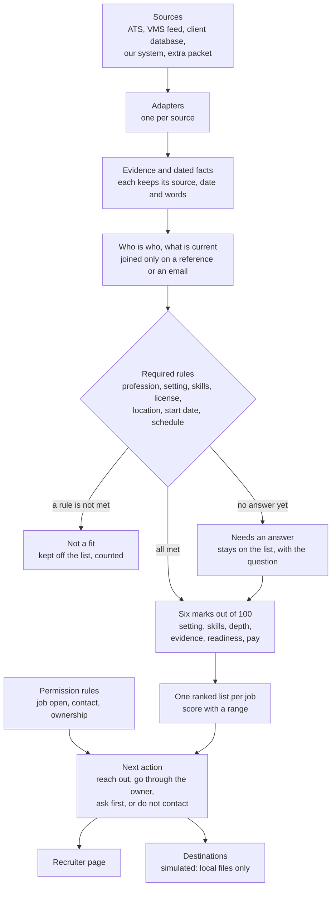
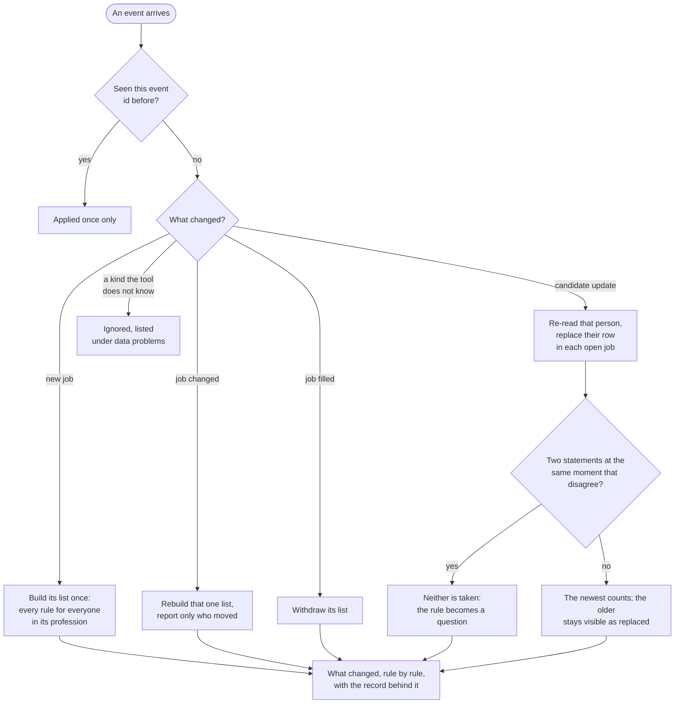
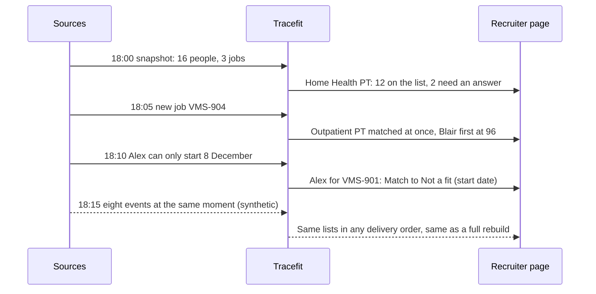

# Tracefit

Candidate–job matching for recruiters. When a job arrives, Tracefit checks every person against it in two stages: **can they do this job** (required rules, pass or fail), then **how good a fit are they** (a score out of 100 from six named dimensions). Every result shows the quote and source behind it, what is still unknown, and what the recruiter is allowed to do next. It recommends. It contacts nobody and submits nothing.



## Run it

Python 3.11 or newer. Nothing to install, no account, no network.

```bash
python3 -m shortlist
```

Then open http://127.0.0.1:8765.

The product is Tracefit; its code package and commands are named `shortlist`, after the list of people it builds for each job.

```bash
python3 -m unittest discover -s tests
```

| Command | What it shows |
|---|---|
| `python3 -m shortlist replay` | The demo in text: the 18:00 snapshot, the 18:05 new job, the 18:10 candidate update |
| `python3 -m shortlist baseline` | A simple field-and-keyword matcher on the same data, beside Tracefit (the comparison in the evaluation, run) |
| `python3 -m shortlist worked` | Four candidates evaluated side by side ([docs/WORKED_EXAMPLE.md](docs/WORKED_EXAMPLE.md)) |
| `python3 -m shortlist audit` | The checker: every result against the product's own rules |
| `python3 -m shortlist burst` | Eight **synthetic** events at the same moment on the supplied data: what changed, and the same lists in 30 delivery orders |
| `python3 -m shortlist explain VMS-901 C2` | Every rule for one person and one job |
| `python3 -m shortlist coverage` | Every rule ran for every pair; what the text reader could not read |
| `python3 -m shortlist health` | Data problems the tool worked around |
| `python3 -m shortlist publish` | Write the shortlists to the simulated destinations (local files in `out/`) |
| `python3 tests/scenario_base.py` | 110 synthetic situations, each passing or failing by name |
| `python3 tests/test_rewording.py` | 163 reworded sentences: a "no", a doubt or a passing mention is not read as a "yes" |
| `python3 tests/test_own_criteria.py` | 37 typed phrases and 22 institutions against synthetic résumés, with the known limits listed |
| `python3 bench/benchmark.py --n 100000` | The synthetic scale benchmark |
| `python3 bench/benchmark.py --n 20000 --workers 1,2,4` | The same lists built on 1, 2 and 4 worker processes, checked identical and timed (also run at 100,000 on a 16-core cloud machine; see the architecture doc) |

Add `--overlay feed_only` or `--overlay strict_pay` to a `python3 -m shortlist` command (all but `worked`) to see another client's settings.

## Five-minute demo

1. **Home Health PT.** The banner says the account manager's note is ahead of the vendor feed; **See details** shows both versions and their sources. The list is one ranked list of the 12 people a recruiter could act on, top 10 first, then **Show next 2**.
2. **The list.** Each card shows the score, one line on what sets the person apart, and the next action; the evidence is one click away, in the person's panel. R01, R02 and R03 differ in the supplied file only by id and email, so the page groups them, says their documents are identical, marks their order arbitrary, and names what to ask each to tell them apart. The people ruled out are behind the **not a fit** link above the list. R08 **needs an answer** and sits ninth, where the score puts them, with what is missing. R11 passes everything but asked not to be contacted, so R11 is listed last.
3. **Open R04.** **Why this score** draws the six dimensions as a radar: R04 loses 30 points on evidence because "I have three years" is not supported by the dated history. Every rule below opens to its quote. **Show everything** opens it all.
4. **Rank by.** Pick **Closest to our work** (setting at 40%) or **Within budget**, or move a slider: the list re-ranks. Tick **Can act now** and R11 leaves. Under **Add your own**, type any phrase (`sports injury`) or any school or institution: the list narrows to the people whose own documents say it, and the card shows the sentence. Weights and filters never move anyone past a required rule.
5. **Compare** R04, R06 and R09: radars overlaid, rows that differ highlighted, plus what each lists on their résumé that no rule checks.
6. **Demo → A new job arrives.** The outpatient job appears, already matched. Blair, an outpatient therapist since 2016, is the top match at 96, well clear of the rest, and goes through recruiter R2.
7. **How this list was made**, under the list. For the home-health job: 16 people on file, 12 on the list, 4 not a fit. **Show the whole process** opens the points that decided it, the weights drawn as a web, and every step from the sources to the next action, with the count on each rule.
8. **Demo → A candidate sends an update.** Alex can now only start 8 December. One result changes; **View** opens it on the rule that changed, with the old message shown as replaced.
9. **Demo → Settings profile → Vendor feed only.** With the account manager's note ignored, nobody qualifies for the home-health job. That is the client's first open question.

## How it works

**From the sources to a recruiter's list.** Every step keeps the source, the date and the exact words, so each result can be traced back.



**When something changes.** Only what the event touches is redone. Events that carry the same timestamp give the same lists whichever arrives first.



**The demo, in time order.** The first three steps are the supplied data. The last is a synthetic burst (`python3 -m shortlist burst`).



## What is in it

| Folder | What is in it |
|---|---|
| `config/` | Every setting: sources, destinations, rules, dimension weights and presets, thresholds, source precedence, freshness windows, divisions, vocabulary. Overlays are alternative client profiles. |
| `shortlist/sources/`, `shortlist/sinks/` | One adapter per source and per destination. Matching imports neither. |
| `shortlist/extract.py`, `resume.py` | Reading text into dated facts with their exact words; reading whole résumés for the person's panel. |
| `shortlist/world.py` | Who is who, what is currently believed, what it replaced. |
| `shortlist/rules.py`, `dimensions.py`, `matching.py` | The required rules, the quality score, order, next action. |
| `shortlist/pipeline.py`, `server.py`, `web/` | Replay, the running-service path, the page. |
| `shortlist/audit.py`, `model_reader.py`, `workers.py` | The checker; an optional guarded language-model reader (off); list building on several worker processes (used by the benchmark). |
| `shortlist/baseline.py` | A simple matcher for comparison only. Not part of the product. |
| `tests/`, `bench/` | 231 tests, 110 scenarios, the rewording sweep; the synthetic benchmark. |

## What is real and what is simulated

| Part | Status |
|---|---|
| The four supplied sources and the supplement, text reading, resolution, required rules, quality score, replay, recruiter page, checker | Implemented, on the supplied data |
| Recruiter weights, presets, filters and typed criteria (a phrase, a school); source precedence; résumé background and links | Implemented |
| Working at size: a screenful at a time, explanations on demand, events applied one at a time | Implemented; speed measured on **synthetic** data |
| Destinations (JSON, CSV, notifications) | **Simulated**: local files only |
| Language-model reader | Built behind a guard, **off, never run against a real model**; tested only with made-up stand-ins |
| Database, queue, several machines, live connections, logins | Designed, not built |
| Credential checks | Not done: every license and certificate is shown as reported |

The text reader is pattern-based and is the weakest part: wording unlike the sample's can be left unread or misread. [Evaluation](docs/EVALUATION.md) says what independent review found and what is still open.

More: [Architecture](docs/ARCHITECTURE.md), also as [one illustrated page](docs/architecture.html) (open the file in a browser after cloning; GitHub shows its source) · [Evaluation](docs/EVALUATION.md) · [Handoff](docs/HANDOFF.md), with the [questions for the client](docs/HANDOFF.md#questions-for-the-client) · [Worked example](docs/WORKED_EXAMPLE.md)
