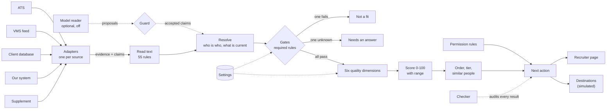
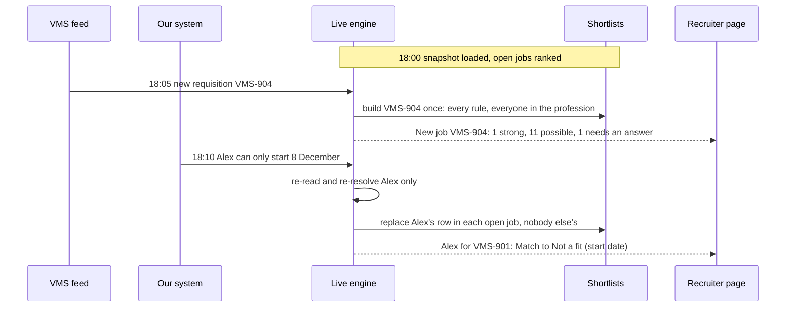
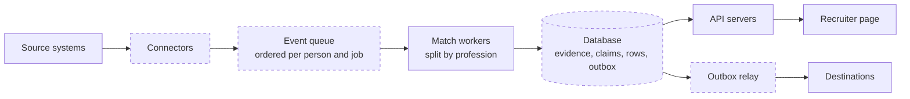

# Architecture and approach

## The idea

The same person and the same job are described differently, at different times, by sources of different authority, and much of what matters is in free text. So Tracefit keeps every fact with its source, date and exact words, decides what is currently believed without throwing the rest away, and then asks two separate questions about each person: **can they do this job**, and **how good a fit are they**. A recruiter sees the answer, the quote behind it, what is still unknown, and what they may do next.

1. **Translate.** One adapter per source turns records into *evidence* (a record, résumé, note or message) and *claims* (one fact from one piece of evidence). Adapters decide nothing.
2. **Read.** 55 text rules turn free text into claims, each keeping its clause. They tell a skill described from a skill denied ("I have not used…") and from a skill merely mentioned as missing ("No OASIS detail supplied"), and respect who is speaking: a recruiter's note cannot assert a candidate's skill. A sentence with a negation or doubt the reader cannot place never yields a yes; it is left as a question.
3. **Resolve.** Records join into one person only on an explicit reference or an identical email, never on a name or a shared `info@` mailbox. Every person keeps a unique id (source plus that source's record id); two people who share a name stay apart, and their cards show which record each is. For each fact the configured **source precedence** decides which statement counts (newest by default), and the others stay visible as replaced. A fuller rendition of a résumé is the same evidence, not a second source.
4. **Gates.** Required rules, each met, not met or unknown, with the quote on both sides.
5. **Score.** For each person, six dimensions computed from those same rule results.
6. **Decide.** Tier, order, grouping of identical people, and a next action from the permission rules.

## Matching and scoring

### Stage 1: gates decide who qualifies

| Rule | Required by default | Reads |
|---|---|---|
| Profession | Yes | Structured profession |
| Experience in the job's care setting | When the posting requires it | Dated roles, claims, notes ("PT" alone does not say home health or outpatient) |
| Skills and tools | When the posting requires them | Résumé, profile, messages; a candidate's own denial wins |
| License in the job's state | Yes | As reported, never as verified |
| Board and certificates | Yes | Including the "other boards" route for the ED job |
| Location | Yes | Home, preferences, later withdrawals |
| Start date, schedule and length | Yes | Messages and records |
| Shift dates | Yes | Each listed shift against what the candidate offered, declined, or an assignment occupies |
| Pay | No: preferred | The ask against the approved rate |

A required rule not met means **not a fit**. One that cannot be answered means **needs an answer**: missing information is a question, never a no. No score can lift anyone past a gate. A license, or a shift a doctor declined, is not something a better résumé can make up for.

### Stage 2: the quality score ranks those who pass

| Dimension | Default weight | 100 means | Lowered by |
|---|---|---|---|
| Setting | 25 | Dated experience in the job's setting, or at an employer the client names | Experience with no dates (70) |
| Skills | 20 | Every skill the job asks for | Missing or denied skills; preferred count half |
| Depth | 15 | Documented years at twice the minimum (at least three) | Fewer years; claimed years count at most half |
| Evidence | 15 | Nothing contradicts or outdates the facts used | A claim the records do not support (−30), a newer message that could not be read (−30), an answer past its freshness window (−15) |
| Readiness | 15 | Start, schedule and shifts met, replied in the last week | Unmet availability; no recent reply |
| Pay | 10 | Asks at or below the approved rate | 10 points for each 1% above |

The score is the weighted average of the dimensions that apply. An unknown answer counts as half and widens the **range**: the score if every unknown turned out no, and if every one turned out yes. Internally a person is a **match** when every gate passes and the score holds at or above 80 even if every unknown turns out no, and a **possible match** otherwise. The page shows the score and the rule blocks rather than these words; the only badge is **Needs an answer**.

Every point traces to a rule result and its quote, so the person panel shows each dimension as a radar and a line of plain words. [WORKED_EXAMPLE.md](WORKED_EXAMPLE.md) walks four real candidates through both stages; under the old count-the-rules score two of them, R01 and R04, tied at 100.

**Why rules and not a similarity model.** The recruiter must be able to check every result; the policies (which version of a requirement applies, whether pay is a ceiling, who may be contacted) are the client's decisions and must be visible and changeable; and the same input must give the same output with no paid service. The cost is that facts must first be read out of text. That limit is measured, not hidden ([EVALUATION.md](EVALUATION.md), experiment 8).

### Similarly qualified candidates

Each job has **one list**: everyone who passes every required rule, plus everyone a required rule still has a question for. It is ordered by score, so a person who needs an answer sits where their score puts them, marked with what is missing; high in the list the question is worth asking, low in the list it rarely matters. Anyone who must not be contacted goes last, under their own heading. People a required rule rules out are kept off the list and counted under it. Ties go to three operational tie-breakers (can be acted on sooner, fewer open questions, heard from more recently). People still level are **grouped**: three of the sample's profiles differ only by id and email, so the page says their order is arbitrary rather than invent a difference. It also says when their documents are word for word the same and names what is missing for all of them that would tell them apart: where they live, an unlisted stretch of work history, license details. The same finding appears once under data problems: twelve profiles share one text. Scores within 3 points are marked comparable. **Compare** puts two or three people side by side, rule by rule, with sources, dates and overlaid radars. No tie-breaker uses a personal attribute.

**A recruiter's own criteria.** Beyond the weights, a recruiter can type a phrase ("wound care") or a school. The list narrows to the people whose own résumé, profile or messages say it, and each card shows the sentence and its source. Words are matched whole, whatever their case, accents, hyphens or plural ("art" is not in "start"; "injury" finds "injuries"). Any institution can be typed; only education and training lines are searched, never an employer. A sentence that says it is missing ("no wound care experience") does not count, and a later denial beats an earlier mention. A different word for the same thing is not found ("kids" will not find "pediatric"); `tests/test_own_criteria.py` lists that limit with the cases that pass. This filters; it never changes a score or a required rule. Links found on a résumé are shown as written and never fetched.

## What a client can configure

Everything below is in `config/default.toml`, with per-division overrides and whole-profile overlays. The page also lets a recruiter change the weights and filters for themselves, without touching the settings.

| Setting | Example |
|---|---|
| Which rules are gates | `[rules.pay] level = "hard"` makes pay a ceiling (the `strict_pay` overlay) |
| Dimension weights, per division | Locums weigh readiness 30 and pay 5 |
| Presets on the page | "Closest to our work" (setting at 40), "Experience first", "Can start soonest", "Within budget" |
| How many people a list opens on | `[matching] top_n = 10`; the page then offers the next 10 |
| Target employers | Experience at agencies the client names counts as full setting experience |
| Source precedence, per fact | `"req.start" = ["vms", "ats"]`: the vendor feed is the authority on start dates |
| Requirement changes from notes | `provisional` (use and flag), `feed_only`, `trusted`; and whose notes count |
| Freshness windows | Availability 30 days, 14 for locums |
| Who may assert what | A recruiter's note may record availability, never a skill |
| Thresholds, unknown credit, tie margin, top N | Strong at 80; unknown counts half |
| Vocabulary | Professions, settings, skills, certificates: a new division is configuration, not code |

Deliberately fixed: every rule runs for every pair; every fact keeps its source; credentials are never called verified; nothing is sent. Settings that name a rule the engine does not have are refused at start.

## Sources and destinations

The matching modules import no adapter, and no adapter imports matching code; a test reads the imports to keep it that way. **Adding a source** is one function that emits evidence and claims, plus a `[[sources]]` block: the supplement arrived in a different shape and went in as a fifth source with a 35-line adapter. **Adding a destination** is one function that receives a plain payload (job, people, tier, score, next action, questions). A test adds a synthetic source and destination at run time and checks that nobody else's result moves.

## Responding to change

A job whose requirements change is rebuilt and only the people who moved are reported; a job that closes withdraws its list; a reopened job is announced as reopened. An event delivered twice is applied once; events out of order are applied by their own dates. A test checks that applying events one at a time gives exactly the rows, totals and messages of rebuilding from scratch, on the sample and all 102 scenarios.

## Scale, latency and cost

Each piece of work is tied to what changed, not to the size of the database:

| Work | Grows with | When |
|---|---|---|
| Read and resolve a record | That record | Once, on arrival |
| Build a job's shortlist | People in its profession (an index sets the rest aside; unknown profession stays in) | Once, when the job arrives or changes |
| Apply a candidate update | Open jobs in their profession | Once per update |
| Show a screenful; open one person | 25 rows; one person | On each view |
| A recruiter's own weights or filters | One list | On each change |

A shortlist is one compact row per person per job (tier, score, dimensions, next action, the line on the card); the full explanation is rebuilt when someone opens that person, and a test checks it cannot differ. The page asks for 10 people at a time, then the next 10 (the benchmark times a screenful of 25). A destination gets the top 200 per job and the totals.

**Measured** on synthetic people, one process, in memory, on an 8 GB laptop. Before the 100,000 run the laptop had about 5 GB of swap in use by other apps, so its worst cases include waiting on the disk; the 20,000 run stays under 460 MB, worker runs included, and is the cleaner measurement. The 20,000 column was re-measured after the page moved to one list per job; the 100,000 column was not, so its two page figures are marked.

| | 20,000 people | 100,000 people |
|---|---|---|
| One-off load: translate, read, link, resolve | 8.5 s | 52 s |
| People in the job's profession | 6,126 | 30,047 |
| **New job → ranked shortlist** (median of 11) | **0.63 s** | **5.0 s** (3.8 to 6.5) |
| **Candidate update → row replaced in 13 open jobs** (median of 200) | **0.2 ms** | **1.6 ms** (p95 9.8) |
| A recruiter moves a weight or filter: list re-scored, first screenful | 8.1 ms | 6.5 ms (before the single list; higher now) |
| A screenful of 25 / one person opened | 2.6 ms / 0.5 ms | 3.5 ms / 0.9 ms (before the single list) |
| Rows held for all 13 open jobs | 79 MB | 354 MB |

One person against one job, all rules and dimensions, costs 130 to 190 microseconds. Full output: [benchmark_20k.txt](benchmark_20k.txt), [benchmark_100k.txt](benchmark_100k.txt). Reproduce with `python3 bench/benchmark.py --n 100000`.

### Worker processes (measured at 20,000 people)

Matching one person against one job needs nothing from anyone else, so the work splits cleanly. `shortlist/workers.py` runs it on several worker processes of one machine, and the benchmark compares 1, 2 and 4 (`--workers 1,2,4`). One worker is the product as it runs today.

| Work | 1 worker | 2 workers | 4 workers |
|---|---|---|---|
| **One new job**, 6,126 people in its profession, split between workers | 0.78 s | 0.50 s (1.6×) | **0.30 s (2.6×)** |
| **All 13 open jobs rebuilt** (a settings change), one job per worker | 8.3 s | 5.2 s (1.6×) | **3.5 s (2.4×)** |
| Every rule for all 20,016 people, profession index off | 2.4 s | 1.4 s (1.7×) | 0.99 s (2.4×) |
| Memory, largest worker | this process | 351 MB | 351 MB |

- **The lists are identical.** A test compares every card and every total from 2, 3 and 5 workers with the one-process list, and the benchmark repeats the check at 20,000. Workers change speed, never an answer.
- **Why 2.6× and not 4×.** The laptop has four fast and four slow cores and was running other apps, and one process still receives the rows and orders the list.
- **What this is not.** It is one machine. There is no queue, network or database here, so it measures the matching step of the service design below, not the service.
- **What it suggests at 100,000** (estimate, from the measured ratio): a new job in about 2 s on four workers instead of 5.0 s. Each worker costs memory, about 350 MB at 20,000 people.
- **What measuring found.** The first run was slower with workers than without. Formatting a date through the C library is about four times slower inside a forked process on macOS; dates are now formatted in plain code, which also makes output independent of the machine's language settings.

**Estimates, not measured.** A thousand open jobs in one profession would make a candidate update re-check about a thousand pairs: roughly 0.2 s. Rebuilding a thousand lists of 30,000 after a settings change: about 80 minutes of one core, divisible across workers (measured above at 2.4× on four). **Cost:** with no model the only running cost is one modest machine. A model reader, if the client wanted one, is paid once per document read (on arrival, and again only if it changes), never per match; answers are saved and replayed.

**Validation with the client:** replay a real day of events at production volume against a copy of their data, record event-to-shortlist time at the median and 95th percentile, and watch memory over a week. The benchmark script is that harness with synthetic adapters in place of real ones.

### As a running service (designed, not built)

Dashed parts are designed, not built. The worker split is the one part now measured, on one machine (above). Each plugs into a seam that exists today: an adapter already takes one record at a time, `Live.ingest` takes one event, `World.apply` takes one batch, and `Shortlist.page` and `patch` read and replace one row. Writes and reads meet only in the database, so a page never waits for a shortlist to build. Build order: store evidence and rows; add the queue and one real connector and replay a real day; add sign-in and a change log; split workers only if the replay says a new job takes too long.

## Reading text safely, and an optional model

A false yes puts someone on a shortlist they should not be on, so the reader is built to leave text unread rather than misread it. A sweep of 124 reworded sentences checks that a "no" or an "unsure" is never read as a "yes", and that every way of saying "don't contact me" is caught. When a newer message on a topic cannot be read, an older yes on that topic becomes a question instead of standing.

A language model can be switched on as a **second reader** (off by default, never run here). Its proposals count only if a guard of ordinary code agrees: the quote is word for word in one sentence, mentions the thing claimed outside any understood negation, uses the vocabulary, comes from a kind of document allowed to say it, and comes from a sentence with no doubt. Disagreement with the rules becomes a question. It can never lift a no-contact request. Against a stand-in model that says yes to everything, nobody's tier rises. Sending candidate text to a provider needs the client's agreement first.

## The checker

`python3 -m shortlist audit` reads every result and confirms the product's own rules hold: the tier follows from the gates; the score is exactly the weighted average of its dimensions; every quote was really recorded by its evidence; no skill counts on a recruiter's impression; nothing counts on a doubtful or future-dated sentence; nobody blocked or owned by another recruiter is marked "reach out"; nothing is called verified; the list is in its stated order. It is clean on the sample, both overlays, all 102 scenarios and with the lying model on, and a test plants twelve kinds of mistake to show each check catches its own.

## What is general, and what is tied to this sample

General, and tested on synthetic data that is not the sample: adapters and failure handling, identity, precedence, every rule, both scoring stages, events, paging, the checker. No code names a person, job or record.

Tied to this sample, and first to revisit with real data: the text reader's 55 rules and the six meanings it recognises in job notes; the vocabulary for these two divisions; and the weights, which are reasoned defaults, not calibrated. Calibrating them needs outcomes the client has and the sample does not: who was submitted, interviewed and placed.
