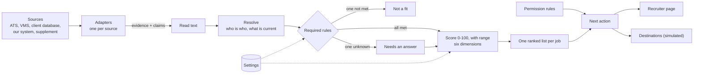
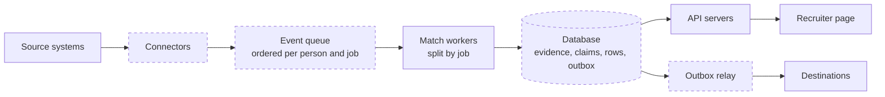

# Architecture and approach

## The idea

The same person and job are described differently, at different times, by sources of different authority, and much of what matters is in free text. Tracefit keeps every fact with its source, date and exact words, decides what is currently believed without discarding the rest, and asks two separate questions about each person: **can they do this job**, and **how good a fit are they**. A recruiter sees the answer, the quote behind it, what is still unknown, and what they may do next.

1. **Translate.** One adapter per source turns records into *evidence* (a record, résumé, note or message) and *claims* (one fact from one piece of evidence). Adapters decide nothing.
2. **Read.** Text rules turn free text into claims, each keeping its sentence. They tell a skill described from one denied ("I have not used…"), one reported missing ("No OASIS detail supplied") and one only mentioned ("my colleague handles it"). They respect who is speaking: a recruiter's note cannot assert a candidate's skill. A sentence the reader cannot place never yields a yes; it is left as a question.
3. **Resolve.** Records join into one person only on an explicit reference or an identical personal email, never on a name, a shared mailbox or a placeholder. For each fact the configured **source precedence** decides which statement counts (newest by default); the others stay visible as replaced. A fuller copy of a résumé is the same evidence, not a second source.
4. **Required rules**, each met, not met or unknown, with the quote on both sides.
5. **Score** from six dimensions computed from those same rule results.
6. **Decide** the order, the grouping of people who are level, and a next action from the permission rules.

## Matching and scoring

### Stage 1: required rules decide who is on the list

| Rule | Required | Reads |
|---|---|---|
| Profession | Yes | The profession field ("Physician Assistant" is not "Physician") |
| Experience in the job's care setting | When the posting requires it | Dated roles, claims, notes. "PT" alone does not say home health or outpatient |
| Skills and tools | When the posting requires them | Résumé, profile, messages; a candidate's own denial wins |
| License in the job's state | When the posting names one | As reported, never as verified |
| Board and certificates | When the posting names them | Including the "other boards" route for the ED job |
| Location | Yes | Home, preferences, later withdrawals |
| Start date, schedule, length, shift dates | Yes | Messages and records; each shift against what was offered, declined or already occupied |
| Pay | No: preferred | The ask against the approved rate |

A required rule not met means **not a fit**. One that cannot be answered means **needs an answer**: missing information is a question, never a no. No score lifts anyone past a required rule, and someone ruled out is not scored or questioned further.

### Stage 2: the score orders the list

| Dimension | Weight | 100 means | Lowered by |
|---|---|---|---|
| Setting | 25 | Dated experience in the job's setting, or at an employer the client names | Experience with no dates (70) |
| Skills | 20 | Every skill, tool and preferred certificate the job asks for | Missing or denied skills; a preferred item counts half; qualifying by an alternative board route earns two thirds |
| Depth | 15 | Documented years at twice the minimum (at least three) | Fewer years; claimed years count at most half |
| Evidence | 15 | Nothing contradicts or outdates the facts used | A claim the records do not support (−30), a newer message that could not be read (−30), a stale answer (−15) |
| Readiness | 15 | Start, schedule and shifts met, replied in the last week | Unmet availability; no recent reply |
| Pay | 10 | Asks at or below the approved rate | 10 points for each 1% above |

The score is the weighted average of the dimensions the job gives something to measure. An unknown answer counts as half and widens the **range**: the score if every unknown turned out no, and if every one turned out yes. Every point traces to a rule result and its quote. [WORKED_EXAMPLE.md](WORKED_EXAMPLE.md) takes four people through both stages.

**Why rules and not a similarity model.** The recruiter must be able to check every result; the policies (which version of a requirement applies, whether pay is a ceiling, who may be contacted) are the client's decisions and must be visible and changeable; and the same input must give the same output with no paid service. The cost is that facts must first be read out of text, and that is the weakest part: see "Reading text, and its limits" below.

### Similarly qualified candidates

Each job has **one list**: everyone who passes every required rule, plus everyone a required rule still has a question for, ordered by score. Someone who needs an answer sits where their score puts them, marked with what is missing. Anyone who must not be contacted is listed last. Scores within 3 points are marked comparable, and ties go to three operational tie-breakers: can be acted on sooner, fewer open questions, heard from more recently. No tie-breaker uses a personal attribute.

People level on every rule, permission check and dimension are **grouped**. Three of the sample's profiles differ only by id and email, so the page says their order is arbitrary rather than invent a difference, says their documents are identical, and names what to ask each to tell them apart. **Compare** puts two or three people side by side, rule by rule, with sources.

A recruiter can also type a phrase or a school. The list narrows to people whose own documents say it, and each card shows the sentence. This filters; it never changes a score.

## What a client can configure

Everything is in `config/default.toml`, with per-division overrides and whole-profile overlays (`feed_only`, `strict_pay`). A mistyped setting stops the tool with a message; it never quietly turns a rule off.

| Setting | Example |
|---|---|
| Which rules are required | `[rules.pay] level = "hard"` makes pay a ceiling |
| Dimension weights, per division | Locums weigh readiness 30 and pay 5 |
| Presets on the page | "Closest to our work", "Experience first", "Can start soonest", "Within budget" |
| Source precedence, per fact | `"req.start" = ["vms", "ats"]`: the vendor feed is the authority on start dates |
| Requirement changes from notes | `provisional` (use and flag), `feed_only`, `trusted`; and whose notes count |
| Freshness windows | Availability 30 days, 14 for locums |
| Who may assert what | A recruiter's note may record availability, never a skill |
| Thresholds, unknown credit, tie margin, list size | Unknown counts half; the list opens on ten |
| Vocabulary and target employers | Professions, settings, skills, certificates: a new division is configuration |

Deliberately fixed: every rule runs for every pair; every fact keeps its source; credentials are never called verified; nothing is sent.

## Sources and destinations

The matching modules import no adapter, and no adapter imports matching code; a test reads the imports to keep it that way. **Adding a source** is one function that emits evidence and claims, plus a `[[sources]]` block: the supplement arrived in a different shape and went in as a fifth source with a 37-line adapter. **Adding a destination** is one function that receives a plain payload. A test adds a synthetic source and destination at run time and checks that nobody else's result moves.

## Responding to change

A new job is matched once against everyone in its profession. A candidate update re-reads that person only and replaces their row in each open job. A job whose requirements change is rebuilt and only the people who moved are reported; a job that closes withdraws its list. An event delivered twice is applied once, and events out of order are applied by their own dates. A test checks that applying events one at a time gives exactly the rows, totals and messages of a rebuild, on the sample and all 110 scenarios.

Events that share a timestamp give the same lists in any delivery order (tested with 40 random orders; `python3 -m shortlist burst` shows it on the supplied data with eight synthetic events). Two statements from one person at the same moment that disagree are not put in order: the rule becomes a question showing both. A job updated and filled at the same moment is treated as filled.

## Scale, latency and cost

Work is tied to what changed, not to the size of the database:

| Work | Grows with | When |
|---|---|---|
| Read and resolve a record | That record | Once, on arrival |
| Build a job's shortlist | People in its profession (an index sets the rest aside) | When the job arrives or changes |
| Apply a candidate update | Open jobs in their profession | Once per update |
| Show a screenful; open one person | The screenful; one person | On each view |
| A recruiter's own weights or filters | One list | On each change |

A shortlist is one compact row per person per job. The full explanation is rebuilt when someone opens that person, and a test checks it cannot differ.

**Measured**, on synthetic people, in memory, one process:

| | 20,000 (laptop) | 100,000 (laptop) | 100,000 (cloud) |
|---|---|---|---|
| One-off load | 8.5 s | 52 s | 83 s |
| People in the job's profession | 6,126 | 30,047 | 30,047 |
| **New job → ranked shortlist** (median of 11) | **0.63 s** | **5.0 s** | **6.0 s** |
| **Candidate update → row replaced in 13 open jobs** (median of 200) | **0.2 ms** | **1.6 ms** | **0.5 ms** |
| A recruiter moves a weight: list re-scored, first screenful | 8.1 ms | not re-measured | 51 ms |
| A screenful of 25 / one person opened | 2.6 ms / 0.5 ms | 3.5 ms / 0.9 ms | 4.8 ms / 1.1 ms |
| Memory after load / at peak | 356 MB / 457 MB | 1.0 GB / 1.2 GB | 1.7 GB / 2.9 GB |

What these numbers depend on:

- **The machines.** The laptop is an 8 GB Apple M3 with other apps running; its 100,000 run was short of memory and predates the single list per job, so read it as a rough second opinion. The cloud machine (16 physical cores, 125 GB, nothing else running) was created for the run and deleted after it. Its cores are slower than the laptop's, so compare ratios within a machine.
- **The profession mix.** The generator puts 30% of people in the job's profession. With the profession index off, one job against all 100,000 takes 19 to 22 s on one process.
- **The data.** Synthetic text is templated on the sample, so load speed says little about real résumés.
- **Later changes.** The runs predate the last changes to the text reader, which add a few checks per sentence to the one-off load. They were not repeated.

Full output is in `docs/benchmark_*.txt`. Reproduce with `python3 bench/benchmark.py --n 100000`.

### Worker processes (measured)

Matching one person against one job needs nothing from anyone else, so the work splits. `shortlist/workers.py` runs it on several processes of one machine. The product itself runs on one process; this measures what more cores would buy. 100,000 people, cloud machine:

| Work | 1 worker | 2 | 4 | 8 | 16 |
|---|---|---|---|---|---|
| One new job, its 30,047 people split between workers | 7.1 s | 4.1 s | 2.6 s | 1.65 s | **1.17 s (6.0×)** |
| All 13 open jobs rebuilt, one job per worker | 78 s | 43 s | 24 s | 14 s | **8.7 s (9.0×)** |

The one-worker figure (7.1 s) is higher than the single-process figure above (6.0 s) because rows are passed between processes. The lists are identical at every worker count: a test compares every card and total, and the benchmark repeats the check on each run. Whole jobs scale better than one split job, which is why the design below splits by job. Each worker holds about 2.5 GB at this size. On the laptop, four workers give 2.6×. Workers need a system that can fork a process (macOS, Linux).

**Estimates, not measured.** A thousand open jobs in one profession would make a candidate update re-check about a thousand pairs: roughly 0.2 s. Rebuilding a thousand lists of 30,000 after a settings change is about 80 minutes of one core, divisible across workers. **Cost:** with no model, the running cost is one machine with about 16 GB of memory, in the order of $100 to $150 a month at public cloud list prices. A model reader, if the client wanted one, would be paid once per document read, never per match.

**Validation with the client:** replay a real day of events at production volume against a copy of their data, record event-to-shortlist time at the median and 95th percentile, and watch memory over a week. The benchmark script is that harness with synthetic adapters.

### As a running service (designed, not built)

Dashed parts are designed, not built: today everything is in one process in memory, and a restart reloads from the sources. Each planned part plugs into something that exists: an adapter takes one record at a time, `Live.ingest` takes one event, and `Shortlist.page` and `patch` read and replace one row. Build order: store evidence and rows; add the queue and one real connector and replay a real day; add sign-in and a change log; split workers only if the replay says a new job takes too long.

## Reading text, and its limits

A false yes puts someone on a shortlist they should not be on, so the reader is built to leave text unread rather than misread it. When a newer message on a topic cannot be read, an older yes on that topic becomes a question. A restriction field nobody could read blocks contact; an impossible date is left unread instead of stopping the tool.

This is still the weakest part, and it is pattern-based. An independent review of the finished tool found about forty sentences outside the sample's wording that were read as a yes, such as "held a Washington license until 2023" and "my colleague handles OASIS". Those are fixed and kept as tests ([EVALUATION.md](EVALUATION.md), experiment 8), but others will exist. Job postings are read by fewer patterns than candidate text: a requirement sentence the reader cannot use is shown on the job as unread, and one it half reads may lose a detail. Real data should start with a review of what is left unread.

A language model can be switched on as a **second reader** (off by default, never run against a real model). Its proposals count only if ordinary code agrees that the quote is word for word in one sentence, says the thing claimed, and holds no doubt. It can never lift a no-contact request.

## The checker

`python3 -m shortlist audit` reads every result and confirms the product's own rules hold: the tier follows from the required rules; the score is the weighted average of its dimensions; every quote was recorded by its evidence; no skill counts on a recruiter's impression; nothing counts on a doubtful or future-dated sentence; nobody blocked or owned by another recruiter is marked "reach out"; nothing is called verified. It checks consistency, not whether the rules are the right ones.

## What is general, and what is tied to this sample

General, and tested on synthetic data that is not the sample: adapters and failure handling, identity, precedence, every rule, both scoring stages, events, paging, the checker. No matching code names a person, job or record; the two demo scripts (`worked`, `burst`) do.

Tied to this sample, and first to revisit with real data: the text reader's patterns and the six meanings it recognises in job notes; the vocabulary for these two divisions; and the weights, which are reasoned defaults, not calibrated. Calibrating them needs outcomes the client has and the sample does not: who was submitted, interviewed and placed.
